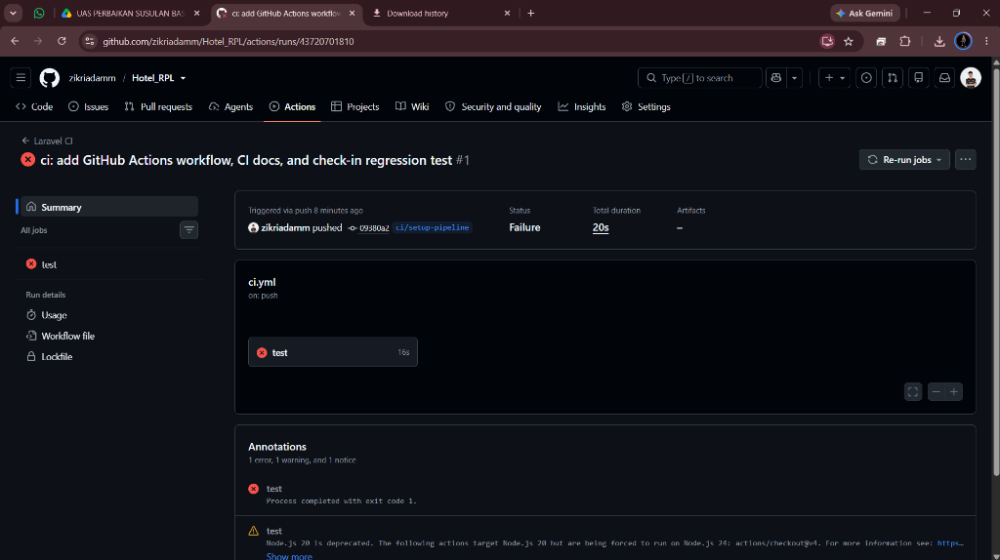
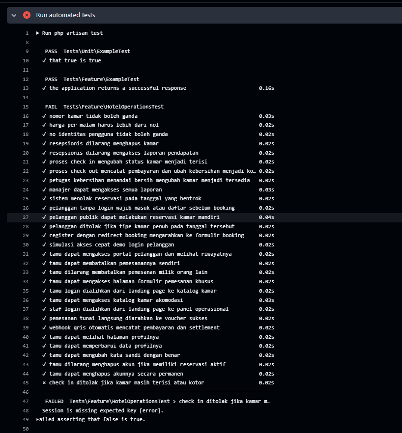
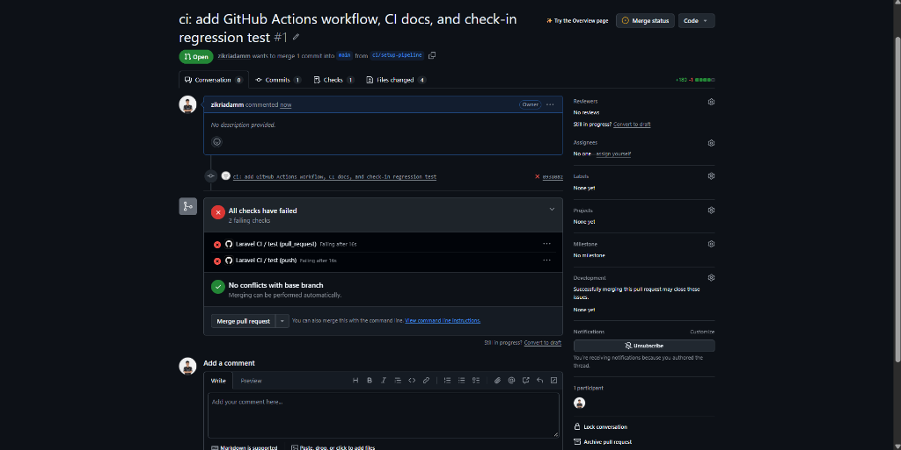
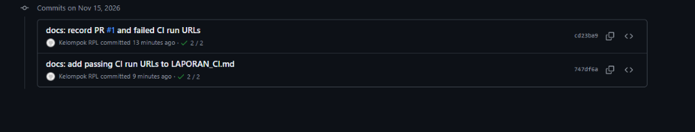
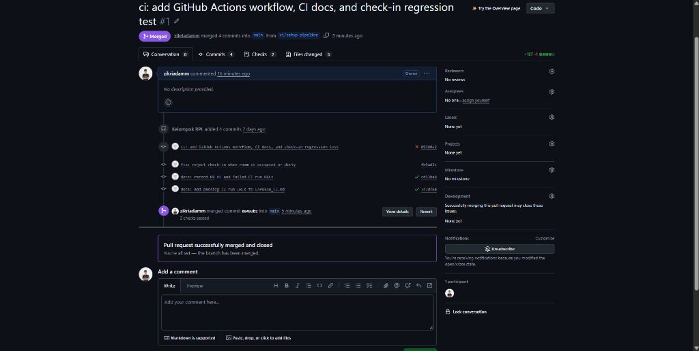

# Laporan Praktik Pipeline CI — Team-Based Project (TBP)

> **Mata Kuliah:** Rekayasa Perangkat Lunak (Teknik Informatika — Universitas Tadulako)  
> **Topik:** Pemeliharaan Perangkat Lunak & DevOps (Pipeline Continuous Integration)  
> **Proyek:** HotelOps / ZSL Residence (`Hotel_RPL` — Laravel 10)

---

## 1. Tautan Repository & Berkas Workflow

- **Repository GitHub:** https://github.com/zikriadamm/Hotel_RPL
- **Berkas Workflow CI:** [`.github/workflows/ci.yml`](../.github/workflows/ci.yml)
- **Trigger Otomatis:** `push` dan `pull_request`
- **Pull Request Pipeline:** https://github.com/zikriadamm/Hotel_RPL/pull/1

---

## 2. Bukti Eksekusi Pipeline (GitHub Actions)

### A. Run Gagal (Before Fix — *Test Fail*)
- **Commit / Tahap:** Commit 1 (`09380a2`) pada branch `ci/setup-pipeline` (`ci: add GitHub Actions workflow, CI docs, and check-in regression test`)
- **URL Run Gagal (`push`):** https://github.com/zikriadamm/Hotel_RPL/actions/runs/43720701810
- **URL Run Gagal (`pull_request`):** https://github.com/zikriadamm/Hotel_RPL/actions/runs/43722719226
- **Status:** `Failed` (Merah) — `1 failed, 31 passed (116 assertions)`
- **Screenshot Bukti Run Gagal:**

  **Ringkasan Run Gagal (`push`):**
  

  **Log Error pada Step `Run automated tests`:**
  

  **Status Checks Gagal pada Pull Request #1 (`push` & `pull_request`):**
  

### B. Run Sukses (After Fix — *Passed*)
- **Commit / Tahap:** Perbaikan check-in (`fb9ad3c` / `cd23ba9`) pada branch `ci/setup-pipeline` (`fix: reject check-in when room is occupied or dirty`)
- **URL Run Sukses (`push`):** https://github.com/zikriadamm/Hotel_RPL/actions/runs/43723142934
- **URL Run Sukses (`pull_request`):** https://github.com/zikriadamm/Hotel_RPL/actions/runs/43723148710
- **URL Run Terbaru (`main`):** https://github.com/zikriadamm/Hotel_RPL/actions/runs/43724492927
- **Status:** `Success` (Hijau) — `32 passed (117 assertions)`
- **Screenshot Bukti Run Sukses:**

  **Status Commit Hijau (2/2 Checks Passed):**
  

  **Pull Request #1 Lolos Seluruh Checks & Merged ke `main`:**
  

---

## 3. Ringkasan Error & Langkah Perbaikan

### Jenis Pemeliharaan
- **Corrective Maintenance** (memperbaiki celah validasi logika bisnis pada proses check-in) dan **Uji Regresi** (menambahkan *regression test* sebelum perbaikan sesuai alur: *Reproduksi → Perbaikan → Verifikasi*).

### Gejala & Pesan Error di Pipeline (`TEST FAIL`)
Pada saat penambahan test regresi `test_check_in_ditolak_jika_kamar_masih_terisi_atau_kotor` di `tests/Feature/HotelOperationsTest.php`, tahap instalasi (`composer install`) dan pemeriksaan sintaks (`php -l`) berhasil, namun tahap `php artisan test` gagal dengan log berikut:

```text
   FAILED  Tests\Feature\HotelOperationsTest > check in ditolak jika kamar masih terisi atau kotor
  Session is missing expected key [error].
Failed asserting that false is true.

  at tests\Feature\HotelOperationsTest.php:652
```

### Analisis Akar Masalah (*Root Cause*)
Method `FrontDeskController::checkIn(Pemesanan $pemesanan)` di `app/Http/Controllers/FrontDeskController.php` sebelumnya hanya memeriksa status pemesanan (`$pemesanan->status !== 'Dipesan'`), tetapi **belum memvalidasi kesiapan fisik kamar** (`$kamar->status === 'Tersedia'` dan `$kamar->status_kebersihan === 'Bersih'`). Akibatnya, resepsionis tetap bisa melakukan check-in pada reservasi baru walaupun kamar tersebut masih berstatus `Terisi`, `Kotor`, atau `Perawatan`.

### Langkah Perbaikan
1. **Validasi pada Controller:** Menambahkan pengecekan kesiapan kamar di `app/Http/Controllers/FrontDeskController.php` sebelum transaksi check-in dijalankan:
   ```php
   $kamar = $pemesanan->kamar;
   if ($kamar->status !== 'Tersedia' || $kamar->status_kebersihan !== 'Bersih') {
       return back()->with('error', "Kamar {$kamar->nomor_kamar} belum siap ditempati (Status: {$kamar->status}, Kebersihan: {$kamar->status_kebersihan}).");
   }
   ```
2. **Verifikasi Lokal & CI:** Menjalankan ulang `php artisan test` dan melakukan `push` ke Pull Request pada branch `ci/setup-pipeline`. Seluruh 32 test (117 assertions) lulus tanpa error.

---

## 4. Panduan Singkat Menjalankan CI

Lihat bagian **Continuous Integration (GitHub Actions)** pada [`README.md`](../README.md#-%EF%B8%8F-continuous-integration-github-actions) untuk daftar prasyarat, tahapan otomatis di GitHub Actions, serta perintah lengkap untuk menjalankan verifikasi CI secara lokal.

---

## 5. Pembagian Peran Tim & Penjelasan

| No | Nama & NIM | Peran dalam Tugas CI | Tanggung Jawab & Kontribusi |
| :-: | :--- | :--- | :--- |
| 1 | Habibi (`F5512530113`) | **DevOps & Workflow Engineer** | Menyiapkan berkas `.github/workflows/ci.yml`, mengonfigurasi trigger `push` & `pull_request`, setup PHP 8.1 + ekstensi `pdo_sqlite`, serta memastikan instalasi dependensi Composer dan `key:generate` berjalan di runner `ubuntu-latest`. |
| 2 | Bayu Jaladara Anantakuva (`F5512520097`) | **Build & Lint Verification Engineer** | Memastikan perintah build, `.env`, dan pemeriksaan sintaks PHP (`php -l` pada `app/`, `routes/`, dan `tests/`) berjalan konsisten di lokal maupun di pipeline CI. |
| 3 | Tabitah Creaselia Belicia Theona (`F5512520086`) | **QA & Regression Tester** | Merancang dan menulis *regression test* (`test_check_in_ditolak_jika_kamar_masih_terisi_atau_kotor`) di `tests/Feature/HotelOperationsTest.php` untuk mereproduksi celah validasi check-in sehingga memicu run gagal (*Test Fail*) di CI. |
| 4 | Muhammad Zikri Adam (`F5512530117`) | **Backend Fix Engineer & Repo Maintainer** | Menganalisis log kegagalan pipeline pada `HotelOperationsTest`, memperbaiki validasi kesiapan kamar di `FrontDeskController::checkIn()`, memverifikasi 32 test lulus, serta mengelola Pull Request #1 hingga merge ke `main`. |
| 5 | Dian Abdillah Melosovic (`F5512530112`) | **Documentation & Evidence Lead** | Memperbarui panduan menjalankan CI di `README.md`, menyusun ringkasan error dan langkah perbaikan di `docs/LAPORAN_CI.md`, serta mendokumentasikan URL dan screenshot run gagal maupun run sukses. |
